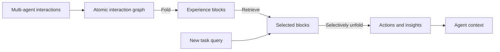

# MAGFold

**Graph memory for reusable multi-agent experience.**

MAGFold turns multi-agent interactions into structured memory. It captures actions, observations, and agent exchanges in atomic interaction graphs, folds them into reusable experience blocks, and selectively unfolds relevant details to guide new tasks.

## Highlights

- **Graph-structured experience.** Connect actions, observations, and agent contributions through typed interaction edges.
- **Reusable interaction blocks.** Organize completed trajectories into blocks with key steps, outcomes, and insights.
- **Coarse-to-fine retrieval.** Select relevant blocks, then unfold their key interactions with configurable retrieval depth and memory budgets.
- **Flexible model setup.** Configure the task solver and memory segmenter independently through OpenAI-compatible endpoints.



## Integrations

A shared command-line interface connects memory methods, multi-agent workflows, and benchmarks.

| Component | Options |
| --- | --- |
| Multi-agent workflows | `autogen`, `macnet`, `dylan` |
| Benchmarks | ALFWorld, PDDL, LifelongAgentBench (`llabench`), HotpotQA |
| Memory methods | MAGFold (`magfold`), GMemory (`gmemory`), MetaGPT (`metagpt`), ChatDev (`chatdev`), no-memory baseline (`empty`) |

## Quick start

Use Linux with Python 3.10:

```bash
conda create -n magfold python=3.10 -y
conda activate magfold
pip install -r requirements.txt
cp .env.example .env
```

Set your OpenAI-compatible endpoint and API key in `.env`:

```bash
OPENAI_API_BASE=https://api.openai.com/v1
OPENAI_API_KEY=replace-me
```

Start with MAGFold on HotpotQA. The runner downloads and caches the validation data automatically:

```bash
python tasks/run.py \
  --task hotpotqa \
  --mas_type autogen \
  --mas_memory magfold \
  --model gpt-4o-mini \
  --env_file .env \
  --num_tasks 3 \
  --run_tag quickstart
```

MAGFold builds memory after each completed task, making prior experience available to subsequent tasks.

## Run experiments

### Embodied tasks

After preparing ALFWorld, run MAGFold with experience and insight retrieval:

```bash
python tasks/run.py \
  --task alfworld \
  --mas_type autogen \
  --mas_memory magfold \
  --model gpt-4o-mini \
  --env_file .env \
  --successful_topk 1 \
  --failed_topk 0 \
  --insights_topk 2
```

### Separate solver and segmenter

Use `--model` for task solving and `--segmenter_model` for memory construction. A segmenter endpoint can be configured with `--segmenter_env_file`.

```bash
python tasks/run.py \
  --task hotpotqa \
  --mas_type autogen \
  --mas_memory magfold \
  --model gpt-4o-mini \
  --segmenter_model gpt-4o-mini \
  --env_file .env
```

### Task selection and memory settings

Select individual tasks or ranges with `--task_ids`:

```bash
python tasks/run.py \
  --task pddl \
  --mas_memory gmemory \
  --task_ids 0,3,10-12 \
  --env_file .env
```

Tune MAGFold retrieval and memory settings with `--mem_config_json`:

```bash
python tasks/run.py \
  --task hotpotqa \
  --mas_memory magfold \
  --env_file .env \
  --mem_config_json '{"block_top_k": 3, "max_memory_tokens": 2000}'
```

Explore all command-line options with `python tasks/run.py --help`.

## Benchmarks

### ALFWorld

Prepare [ALFWorld](https://github.com/alfworld/alfworld) and its task index with this layout:

```text
data/alfworld/alfworld_tasks_suffix.json
data/alfworld/json_2.1.1/train/
data/alfworld/json_2.1.1/valid_seen/
data/alfworld/json_2.1.1/valid_unseen/
data/alfworld/logic/alfred.pddl
data/alfworld/logic/alfred.twl2
```

Dataset paths and the evaluation split are configured in [tasks/env_configs/alfworld_config.yaml](tasks/env_configs/alfworld_config.yaml).

### HotpotQA

[HotpotQA](https://huggingface.co/datasets/hotpotqa/hotpot_qa) uses the `distractor` validation split. The runner stores its local cache at `data/hotpotqa/hotpot_dev_distractor_v1.json`.

### LifelongAgentBench

[LifelongAgentBench](https://huggingface.co/datasets/csyq/LifelongAgentBench) provides database, operating-system, and knowledge-graph tasks. Data is loaded from Hugging Face and cached under `data/llabench/`.

Choose a sub-environment with `LLABENCH_ENV`:

```bash
export LLABENCH_ENV=db_bench
```

Available values are `db_bench`, `os_interaction`, and `knowledge_graph`.

### PDDL

The planning adapter uses [PDDLGym](https://github.com/tomsilver/pddlgym). Place the benchmark split annotations at `data/pddl/test.jsonl`, with a `difficulty` field in each row.

The task order is `barman` (20), `blockworld` (10), `gripper` (20), and `tyreworld` (10).

## Configuration

| File | Settings |
| --- | --- |
| [configs/configs.yaml](configs/configs.yaml) | LLM generation, request timeouts, and retries |
| [tasks/configs.yaml](tasks/configs.yaml) | Task limits, multi-agent workflows, and memory retrieval |
| `tasks/env_configs/` | Dataset paths and environment settings |
| [rl/configs/base.yaml](rl/configs/base.yaml) | Segmenter models, GRPO hyperparameters, and reward settings |
| [rl/configs/alfworld.yaml](rl/configs/alfworld.yaml) | ALFWorld segmenter data and rollout settings |

## Logs and memory artifacts

Each run records task actions, observations, rewards, completion status, and token usage:

```text
.db/<model_type>/<task>/<mas_type>/<memory_or_memory_run_tag>/total_task.log
```

MAGFold stores atomic interaction graphs, experience blocks, block edges, and a query index in the run's `magfold/` directory. These artifacts make it possible to inspect how experience is organized and retrieved.
